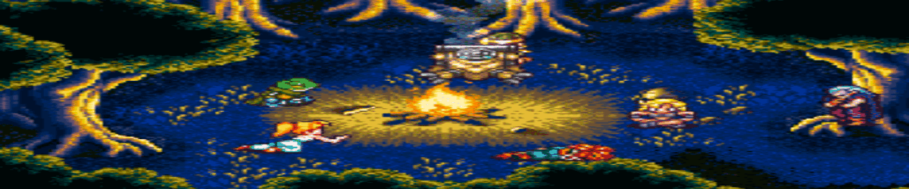

  

<h2 align="center">"It's dangerous to go alone! Take this."</h2>

  
  
  
  
  

## Atualmente

- 🚗 **SisVaga** — Projeto acadêmico desenvolvido em grupo, com foco no monitoramento inteligente de vagas de estacionamento em tempo real, utilizando ESP32, sensores ultrassônicos e interface web.
- 🐍 **Python** — Estudando para ampliar meus conhecimentos.
